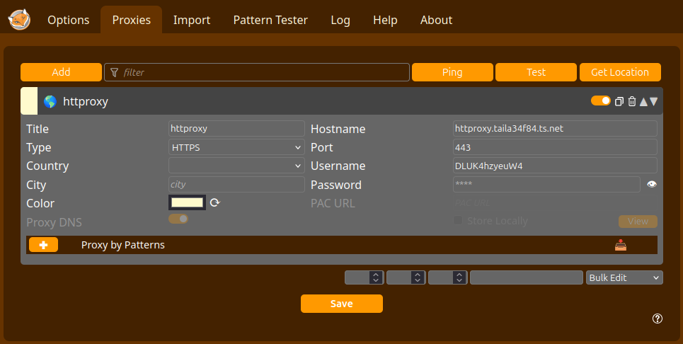
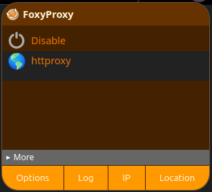
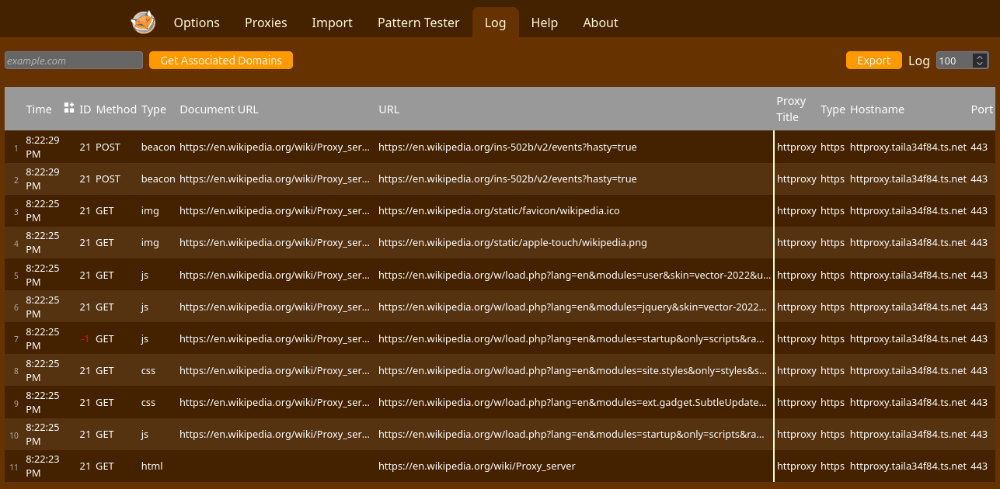

# HTTP Proxy

This proxy allows you to hide your IP address and location from websites you visit.
All interactions and payments with this service are conducted anynomously.

## Getting started

### Top up to get a new `sessionID`.

Pay as you go, you are charged only by data you have transferred.
Price is 0.01 XMR/GB.
Pay in [Monero](https://www.getmonero.org/) to the service wallet address `49xkmbGAq5BahXsy8mYSroYGrZZBU4pcSd8TeURJkXhx4KywwJHXBq6DCZtajUQ9fvJ9wtaJ4opZJFfRJMAmkeWZ76Up3M2`.

#### Do payment and get a transaction ID `txID`.

```
monero-wallet-cli --wallet-file /path/to/your/wallet transfer 49xkmbGAq5BahXsy8mYSroYGrZZBU4pcSd8TeURJkXhx4KywwJHXBq6DCZtajUQ9fvJ9wtaJ4opZJFfRJMAmkeWZ76Up3M2 0.01
# Output: 
# Transaction successfully submitted, transaction <fccff938e692b596388af29c485c9016ccaedb2bc4a406ec5634e7050a3bcf8a>
```

In this example, `fccff938e692b596388af29c485c9016ccaedb2bc4a406ec5634e7050a3bcf8a` is your `txID`.

#### Top up using `txID`, and get a `sessionID`.

```
curl https://httproxy.taila34f84.ts.net/json_rpc -H 'Content-Type: application/json' -d '{"jsonrpc":"2.0","id":"0","method":"topup","params":{"Method":"xmr","PaymentTx":"fccff938e692b596388af29c485c9016ccaedb2bc4a406ec5634e7050a3bcf8a"}}'
# Output:
# {"result":{"ID":"DLUK4hzyeuW4","UsageLimit":1000000000,"Usage":0}}
```

In this example, `DLUK4hzyeuW4` is your `sessionID`, and paying 0.01 XMR gave you a usage limit of `1000000000` bytes (1 GB).
Keep your `sessionID` secret, since anyone who has it can use your quota.

If the server cannot find your payment yet, wait for the transaction to be included in a block (usually a few minutes) and try again.
Each `txID` can only be used to top up once.

### Use `sessionID` in your proxy configuration

Here we use [Foxyproxy](https://github.com/foxyproxy/browser-extension) on Firefox as an example, but you are free to use any software that supports the HTTPS Proxy protocol.

#### Configure Foxyproxy

As shown in the screenshot below, enter the following information:

* Title: pick any name you like, we use `httproxy` in this example
* Type: `HTTPS`, this is very important, do *not* leave it as HTTP (without the trailing S)
* Hostname: `httproxy.taila34f84.ts.net`
* Port: `443`
* Username: your `sessionID` in the above step
* Password: leave it blank or put in anything you want, it does not matter



#### Pick the proxy you configured in the previous step



#### Done!

From now on, websites you visit will no longer know about your IP address nor your location.
You can confirm this from your browser logs as shown below:



## Advanced usage

### Using the proxy directly from the command line

Here we assume you have topped up and your session ID is `DLUK4hzyeuW4`.
Moreover, the target website you want to visit is `https://example.com`.
The below command will fetch the target website through the proxy:

```
curl -x https://DLUK4hzyeuW4:@httproxy.taila34f84.ts.net:443 https://example.com
```

### Querying your current usage

Assuming your session ID is `DLUK4hzyeuW4`, run the below command:

```
curl https://httproxy.taila34f84.ts.net/json_rpc -H 'Content-Type: application/json' -d '{"jsonrpc":"2.0","id":"0","method":"usage","params":{"SessionID":"DLUK4hzyeuW4"}}'
# Output:
# {"result":{"ID":"DLUK4hzyeuW4","UsageLimit":1000000,"Usage":999999}}
```

In this example, your usage limit is `1000000` bytes, while your actual usage is `999999` bytes.
You are close to your limit, so it is recommended you top up your current session using the command in the next section.

### Topping up an existing session

Assuming your session ID is `DLUK4hzyeuW4`, run the below command:

```
curl https://httproxy.taila34f84.ts.net/json_rpc -H 'Content-Type: application/json' -d '{"jsonrpc":"2.0","id":"0","method":"topup","params":{"Method":"xmr","PaymentTx":"your_new_txID","SessionID":"DLUK4hzyeuW4"}}'
# Output:
# {"result":{"ID":"DLUK4hzyeuW4","UsageLimit":1001000000,"Usage":999999}}
```

Here `your_new_txID` is the transaction ID of a new payment made as described in [Do payment and get a transaction ID](#do-payment-and-get-a-transaction-id-txid).
Notice in the above command that we specify your existing session ID `DLUK4hzyeuW4` in the top up call, so the newly paid quota is added to your existing session instead of creating a new one.
This frees you from the hassle of constantly changing your proxy configuration with a new `sessionID`.
In this example, paying 0.01 XMR raised your usage limit from `1000000` to `1001000000` bytes.

When your usage exceeds your usage limit, the proxy responds with `407 Proxy Authentication Required` and the message `payment required, usage ... exceeds limit ... bytes, please top up`.
