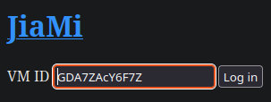
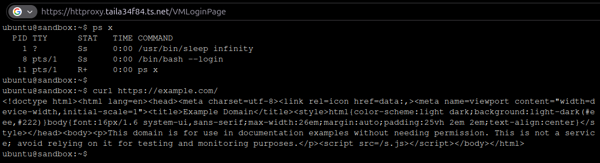

# VM Service

This service allows you to rent virtual machines in a no-kyc, pay-as-you-go manner.
All interactions and payments with this service are conducted anonymously.
No registration needed.

## Getting started

### Top up to get a new `machineID`.

Pay as you go, you are billed by the second, and are free to extend your rental anytime.
For machines with 2 vCPUs and 1GB of RAM, price is 0.000015 XMR/hour ($4.5 USD/month).

Pay in [Monero](https://www.getmonero.org/) to the service wallet address `49xkmbGAq5BahXsy8mYSroYGrZZBU4pcSd8TeURJkXhx4KywwJHXBq6DCZtajUQ9fvJ9wtaJ4opZJFfRJMAmkeWZ76Up3M2`.

#### Do payment and get a transaction ID `txID`.

```
monero-wallet-cli --wallet-file /path/to/your/wallet transfer 49xkmbGAq5BahXsy8mYSroYGrZZBU4pcSd8TeURJkXhx4KywwJHXBq6DCZtajUQ9fvJ9wtaJ4opZJFfRJMAmkeWZ76Up3M2 0.0015
# Output:
# Transaction successfully submitted, transaction <fccff938e692b596388af29c485c9016ccaedb2bc4a406ec5634e7050a3bcf8a>
```

In this example, `fccff938e692b596388af29c485c9016ccaedb2bc4a406ec5634e7050a3bcf8a` is your `txID`.

#### Top up using `txID`, and get a `machineID`.

```
curl https://httproxy.taila34f84.ts.net/json_rpc -H 'Content-Type: application/json' -d '{"jsonrpc":"2.0","id":"0","method":"VMTopup","params":{"Method":"xmr","PaymentTx":"fccff938e692b596388af29c485c9016ccaedb2bc4a406ec5634e7050a3bcf8a"}}'
# Output:
# {"result":{"ID":"GDA7ZAcY6F7Z","UsageLimit":360000,"Usage":0,"Running":true}}
```

In this example, `GDA7ZAcY6F7Z` is your `machineID`, and paying 0.0015 XMR gave you a usage limit of `360000` seconds (100 hours).
Keep your `machineID` secret, since anyone who has it can use your quota.

If the server cannot find your payment yet, wait for the transaction to be included in a block (usually a few minutes) and try again.
Each `txID` can only be used to top up once.

#### Done!

Enter your `machineID` at the top of this page, and you will be logged in to your machine:



Upon logging in, you will see your familiar Linux bash shell. : )



## Advanced usage

### Logging in to your machine programmatically

Here we assume you have topped up and your machine ID is `GDA7ZAcY6F7Z`.
After installing [Go](https://go.dev/) and cloning this project's [repo](https://github.com/fumin/httproxy), running the below command would log you in to your machine from your terminal:

```
go run cmd/vmclient/main.go -url="https://httproxy.taila34f84.ts.net/VMLogin" -id="GDA7ZAcY6F7Z"
```

### Querying your current usage

Assuming your `machineID` is `GDA7ZAcY6F7Z`, run the below command:

```
curl https://httproxy.taila34f84.ts.net/json_rpc -H 'Content-Type: application/json' -d '{"jsonrpc":"2.0","id":"0","method":"VMInfo","params":{"ID":"GDA7ZAcY6F7Z"}}'
# Output:
# {"result":{"ID":"GDA7ZAcY6F7Z","UsageLimit":360000,"Usage":359000,"Running":true}}
```

In this example, your usage limit is `360000` seconds, while your current usage is `359000` seconds.
You are close to your limit, so top up your machine using the command in the next section.
Make sure to top up before your usage reaches your limit: once it does, your machine stops, all its data is erased, and it can no longer be topped up.

### Topping up an existing machine

Assuming your `machineID` is `GDA7ZAcY6F7Z`, run the below command:

```
curl https://httproxy.taila34f84.ts.net/json_rpc -H 'Content-Type: application/json' -d '{"jsonrpc":"2.0","id":"0","method":"VMTopup","params":{"Method":"xmr","PaymentTx":"your_new_txID","ID":"GDA7ZAcY6F7Z"}}'
# Output:
# {"result":{"ID":"GDA7ZAcY6F7Z","UsageLimit":720000,"Usage":359000,"Running":true}}
```

Here `your_new_txID` is the transaction ID of a new payment made as described in [Do payment and get a transaction ID](#do-payment-and-get-a-transaction-id-txid).
Notice in the above command that we specify your existing `machineID` `GDA7ZAcY6F7Z` in the top up call, so the newly paid quota is added to your existing machine instead of creating a new one.
This allows you to preserve all your data and running processes on the same machine, while extending its rental time.
In this example, paying 0.0015 XMR raised your usage limit from `360000` to `720000` seconds.

### Technical details

Your machine's security and privacy are upheld by the latest technology and the industry's highest standards.
It is isolated by [gVisor](https://gvisor.dev/) which powers Google Cloud Platform, and is run under its own unique user, process, and network Linux [namespace](https://en.wikipedia.org/wiki/Linux_namespaces).
All data resides solely in RAM, which means data is immediately and irreversibly erased when your rental terminates.

Connections to your machine use open [standards](https://kubernetes.io/blog/2024/05/01/cri-streaming-explained/#how-does-the-streaming-actually-work), in particular the `v4` and `v5.channel.k8s.io` protocols from [Kubernetes](https://kubernetes.io/).
Using open standards helps secure your connections, and makes it easy for you to automate your machine usage by leveraging existing tools.

The infrastructure hosting your machine is [open source](https://github.com/fumin/httproxy), and security audits are welcome.

## Contact

Mastodon: https://mastodon.social/@shaoyu

X.com: https://x.com/awawfumin

Email: awawfumin@gmail.com
